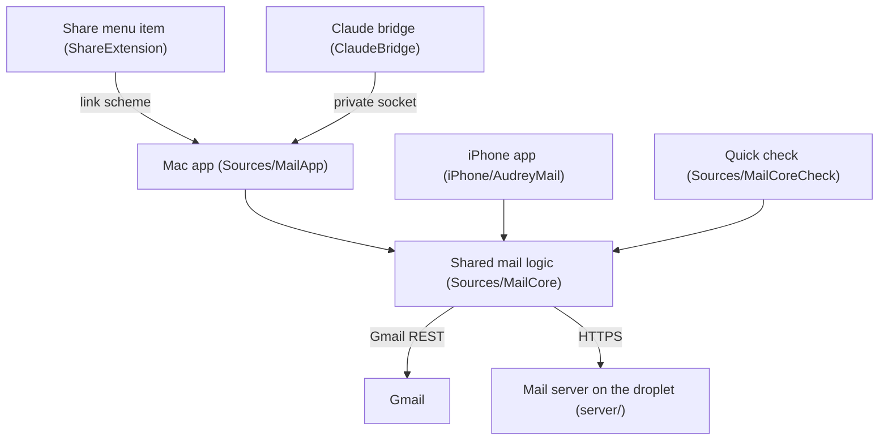

# Audrey Mail: code map

One page. Update it when a part is added, moved or shared differently.

## The parts

| Part | Folder | What it holds |
| --- | --- | --- |
| Shared mail logic | `Sources/MailCore` | Gmail client and pacing, sync engine, stored mail (SQLite), outbox, sign-in core (PKCE), new-sender check and approvals, blocks and rules, folders, Smart tabs, plain-words search, snooze times, Undo Send, to-do sending, Mail server requests. No screens, no AppKit, no Keychain. Swift 6 mode. |
| Mac app | `Sources/MailApp` | Screens, Mac sign-in file and the one-time Keychain move, menu bar, printing, Command Center, home screen, Claude access. Self-test and screenshot harness in debug builds only (`TESTHARNESS`). |
| iPhone app | `iPhone/AudreyMail` | Its own screens and `PhoneStore`; uses MailCore through the local package. `DemoGmail` is its pretend Gmail for tests. |
| Quick check | `Sources/MailCoreCheck` | MailCore's own checks, no app: `scripts/cloud-build.sh --core`. |
| Share menu item | `ShareExtension` | Collects what another app shared and hands it to the Mac app. Sends nothing. |
| Claude bridge | `ClaudeBridge` | Started by the Claude app; passes requests to the running Mac app. Holds no mail and no sign-in. |
| Mail server | `server/mail-share`, `server/mail-timing` | Python services on the droplet: share links ("Copy link to share") and the timing service (Send Later while the Mac is off, and the per-person lists the Mac and phone share). |

## Rules that hold it together

- Anything the Mac and the phone both need goes in MailCore, as `public`. Mac-only code stays out of it.
- Each Mac file is named for what it does (sidebar, toolbar, message list, reading pane, print, menu bar, and so on).
- Any `--` launch switch puts the Mac app in test mode: no Keychain, no real sign-in file.
- Builds and tests run on GitHub, never on John's Mac (see README).
